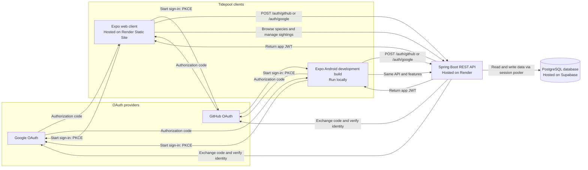
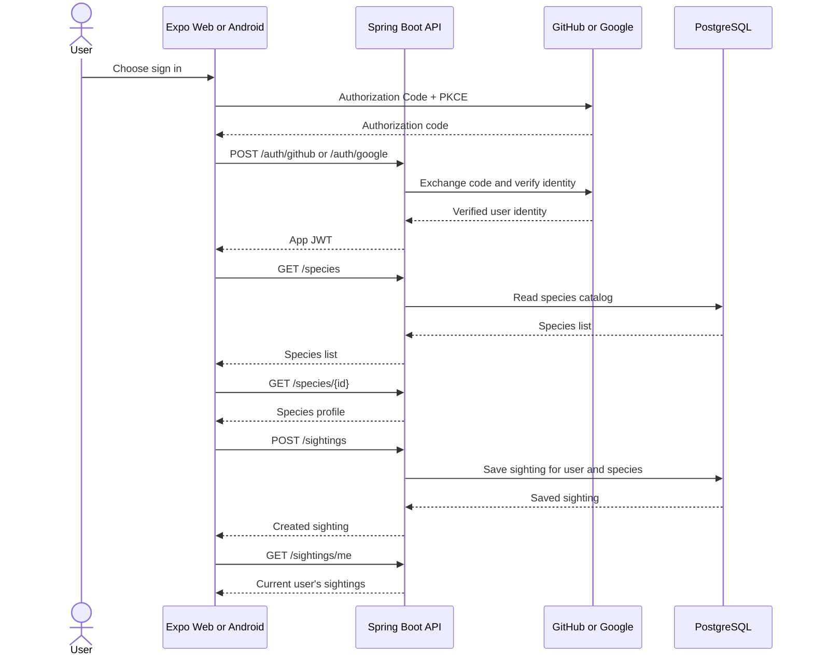

# Architecture: Tidepool

## Architecture and hosting

| Component | Technology | Hosting |
|---|---|---|
| Web client | Expo (web) | Render Static Site |
| Android client | Expo Android development build | Run locally |
| API | Spring Boot REST API | Render |
| Database | PostgreSQL | Supabase (connected through the session pooler) |
| Sign-in | GitHub OAuth and Google OAuth, Authorization Code + PKCE | GitHub and Google |

Both clients call the same API. The clients never talk to the database directly, and the provider secrets stay on the API.

## Data model and API flow

This is the sign-in flow followed by the vertical slice (PRD-3): browse species, open a profile, record a sighting, and see it in "My Sightings." Endpoints are defined in [`openapi.yaml`](openapi.yaml), and tables in [`erd.md`](erd.md).

Errors from any of these calls use the RFC 9457 Problem Details model in [`problem-details.md`](problem-details.md).